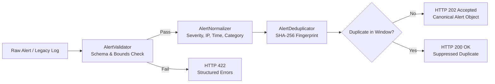

# ThreatPulse SOAR: Alert Ingestion & Normalization Specification

> **IMPORTANT ARCHITECTURAL NOTICE:**
> **Phase 2 does not create incidents or execute response actions.**
> The Alert Ingestion & Normalization layer establishes a deterministic, validated, and normalized boundary between incoming telemetry/legacy logs and the future Phase 3 Correlation and Incident Management subsystems.

---

## 1. Pipeline Overview

The SOAR Alert Ingestion pipeline processes incoming telemetry across 6 discrete, side-effect-limited stages:



1. **Ingestion Request**: Received via REST API (`POST /api/v1/alerts.php`) or the internal Legacy SIEM Bridge (`AlertIngestionService::ingestLegacyLog()`).
2. **Validation**: Enforces field size bounds, RFC-compliant IP formatting, timestamp integrity, and required attributes without executing code.
3. **Normalization**: Canonicalizes IP representations (IPv4/IPv6), harmonizes severity levels (mapping `WARNING` -> `MEDIUM`), standardizes timestamps to `Y-m-d H:i:s`, and preserves the complete uncorrupted security message.
4. **Deterministic Fingerprinting**: Constructs a deterministic SHA-256 hash from canonical attributes combined with a 5-minute sliding time bucket.
5. **Deduplication**: Evaluates whether an identical fingerprint was processed within the active time window. Duplicate alerts are safely acknowledged without alert storm spam.
6. **Audit Record**: Emits non-sensitive ingestion audit records to `audit_log`.

---

## 2. Canonical Alert Schema (`AlertSchema`)

The canonical internal alert object represents all normalized fields consumed by downstream SOAR engines:

| Field | Type | Required | Description |
| :--- | :--- | :--- | :--- |
| `source` | `string` | Yes | Identifying sensor/origin (e.g., `threatpulse_siem`, `suricata_ids`, `waf_sensor`) |
| `source_type` | `string` | Yes | Telemetry category (e.g., `log`, `network_ids`, `waf`, `auth`, `api`) |
| `source_event_id` | `?string` | No | Original event ID or legacy `logs.id` |
| `source_ip` | `?string` | No* | Canonicalized IPv4/IPv6 source address |
| `destination_ip` | `?string` | No | Canonicalized IPv4/IPv6 destination address |
| `source_port` | `?int` | No | Source port (1–65535) |
| `destination_port` | `?int` | No | Destination port (1–65535) |
| `protocol` | `?string` | No | Network protocol (e.g., `TCP`, `UDP`, `ICMP`, `HTTP`) |
| `severity` | `string` | Yes | Canonical severity: `CRITICAL`, `HIGH`, `MEDIUM`, `LOW`, `INFO` |
| `category` | `string` | Yes | Attack category: `SSH`, `SQLi`, `XSS`, `RCE`, `SSTI`, `LFI`, `Other` |
| `signature` | `?string` | No | Detection rule or signature identifier (e.g., `SIG-BRUTE-01`) |
| `message` | `string` | Yes | Raw textual description preserving exact attack payload context |
| `event_timestamp` | `string` | Yes | Event occurrence timestamp (`Y-m-d H:i:s`) |
| `received_at` | `string` | Yes | Ingestion timestamp (`Y-m-d H:i:s`) |
| `mitre_tactic` | `?string` | No | MITRE ATT&CK Tactic (e.g., `Initial Access`, `Execution`) |
| `mitre_technique` | `?string` | No | MITRE ATT&CK Technique (e.g., `T1190`, `T1059`) |
| `ioc_type` | `?string` | No | Primary IOC type: `IPV4`, `IPV6`, `DOMAIN`, `URL`, `MD5`, `SHA256`, `EMAIL` |
| `ioc_value` | `?string` | No | Indicator value (e.g., domain name, file hash, IP) |
| `metadata` | `array` | No | Arbitrary contextual key-value attributes |

*\* Note: An alert must contain at least one identifying indicator (`source_ip`, `ioc_value`, `signature`, `destination_ip`, or `source_event_id`).*

---

## 3. Normalization Rules

### 3.1 Severity Mapping
Existing SIEM telemetry and external feeds utilize divergent severity labels. The normalizer maps all incoming severities into the 5 standard SOAR tiers:

| Ingested Severity | Canonical SOAR Severity |
| :--- | :--- |
| `CRITICAL` | `CRITICAL` |
| `HIGH` | `HIGH` |
| `WARNING` / `WARN` | `MEDIUM` |
| `MEDIUM` / `MED` | `MEDIUM` |
| `INFO` / `INFORMATIONAL` | `INFO` |
| `LOW` / `DEBUG` | `LOW` |
| *Empty / Unrecognized* | `INFO` |

### 3.2 IP Canonicalization
- **IPv4**: Standard dotted-decimal notation without leading zeroes (e.g., `192.168.01.001` -> `192.168.1.1`).
- **IPv6**: Lowercase, compressed zero-group notation via `inet_ntop(inet_pton($ip))` (e.g., `2001:0DB8:0000:0000:0000:0000:0000:0001` -> `2001:db8::1`).
- **Invalid IPs**: Malformed strings fail validation with code `INVALID_IP`.

### 3.3 Attack Categories
Preserves existing SIEM category taxonomy:
- `SSH`: SSH credential brute-forcing, tunnel abuse, and unauthorized key exchanges.
- `SQLi`: SQL injection attempts and database query tampering.
- `XSS`: Cross-site scripting and HTML script tag injection.
- `RCE`: Remote code execution, shell commands, and botnet C2 traffic.
- `SSTI`: Server-Side Template Injection.
- `LFI`: Local / Remote File Inclusion.
- `Other`: General network anomalies, port scans, and uncategorized events.

### 3.4 Timestamps
- Normalizes ISO-8601 strings (`2026-08-25T10:00:00Z`), UNIX epoch timestamps (`1787652000`), and standard SQL datetime strings to canonical `Y-m-d H:i:s`.
- Rejects unparseable date strings with code `INVALID_TIMESTAMP`.

### 3.5 Message Integrity
- Trims outer whitespace but **never strips, escapes, or alters** internal payload characters, quotes, or commands. Security context must remain exact for forensic analysis.

---

## 4. Deterministic Deduplication Algorithm

To prevent alert floods while avoiding schema modifications to `logs`, alerts are fingerprinted using a SHA-256 hash of ordered canonical fields and a sliding time bucket.

### 4.1 Fingerprint Formula
```
TimeBucket = floor(EventUnixTimestamp / BucketSeconds)

CanonicalString = 
  "source:"         + lowercase(trim(source)) + "\n" +
  "source_ip:"      + trim(source_ip) + "\n" +
  "destination_ip:" + trim(destination_ip) + "\n" +
  "category:"       + uppercase(trim(category)) + "\n" +
  "severity:"       + uppercase(trim(severity)) + "\n" +
  "signature:"      + trim(signature) + "\n" +
  "message:"        + trim(message) + "\n" +
  "time_bucket:"    + TimeBucket

Fingerprint = SHA256(CanonicalString)
```

### 4.2 Deduplication Window
- **Default Window Size**: `300 seconds` (5 minutes).
- **Behavior**:
  - **First Occurrence**: Fingerprint is registered; returns `HTTP 202 Accepted` (`duplicate: false`).
  - **Subsequent Occurrence (Within 5 mins)**: Returns `HTTP 200 OK` (`duplicate: true`, `status: "duplicate"`).
  - **Subsequent Occurrence (After 5 mins)**: New time bucket computes a distinct fingerprint, allowing re-alerting if an attack persists across intervals.

---

## 5. REST Ingestion API (`POST /api/v1/alerts.php`)

### 5.1 Request Contract
- **Headers**:
  - `Content-Type: application/json`
  - `Authorization: Bearer <API_KEY>` (or active analyst session cookie)
- **Body Size Limit**: Max `64 KB`.

#### Sample Ingestion Payload
```json
{
  "source": "suricata_sensor_01",
  "source_type": "network_ids",
  "source_ip": "198.51.100.55",
  "destination_ip": "10.0.0.15",
  "source_port": 44120,
  "destination_port": 22,
  "protocol": "TCP",
  "severity": "CRITICAL",
  "category": "SSH",
  "signature": "ET-SCAN-SSH-BRUTEFORCE",
  "message": "SSH brute force password spray detected (25 attempts in 10s)",
  "event_timestamp": "2026-08-25 10:15:00",
  "mitre_tactic": "Credential Access",
  "mitre_technique": "T1110",
  "ioc_type": "IPV4",
  "ioc_value": "198.51.100.55"
}
```

### 5.2 Response Contracts

#### New Alert Accepted (`HTTP 202 Accepted`)
```json
{
  "success": true,
  "status": "accepted",
  "fingerprint": "a3f8c1e2b9d4e7f6a5c8e1d2f4b7a9c3e5f7a1b3c5d7e9f1a3b5c7d9e1f3a5b7",
  "duplicate": false,
  "alert": {
    "source": "suricata_sensor_01",
    "source_ip": "198.51.100.55",
    "severity": "CRITICAL",
    "category": "SSH",
    "message": "SSH brute force password spray detected (25 attempts in 10s)",
    "event_timestamp": "2026-08-25 10:15:00",
    "received_at": "2026-08-25 10:15:01"
  }
}
```

#### Duplicate Alert Suppressed (`HTTP 200 OK`)
```json
{
  "success": true,
  "status": "duplicate",
  "fingerprint": "a3f8c1e2b9d4e7f6a5c8e1d2f4b7a9c3e5f7a1b3c5d7e9f1a3b5c7d9e1f3a5b7",
  "duplicate": true,
  "message": "Identical alert fingerprint seen within 300s time window (Database)."
}
```

#### Validation Failure (`HTTP 422 Unprocessable Content`)
```json
{
  "success": false,
  "status": "validation_failed",
  "error": "validation_failed",
  "fields": [
    {
      "field": "source_ip",
      "code": "INVALID_IP",
      "message": "The source_ip must be a valid IPv4 or IPv6 address."
    }
  ],
  "duplicate": false
}
```

#### Unauthorized (`HTTP 401 Unauthorized`)
```json
{
  "success": false,
  "error": "unauthorized",
  "message": "Authentication required. Provide valid analyst session or Authorization: Bearer <API_KEY> header."
}
```

---

## 6. Security Controls & Protections

1. **Authentication Enforcement**:
   - Accepts either active browser sessions or `Authorization: Bearer <API_KEY>`.
   - API tokens passed in query strings, request bodies, or URLs are **strictly rejected** to avoid token leakage in access logs or browser history.
2. **Inert Data Handling (No Execution)**:
   - Malicious strings, XSS payloads (`<script>`), SQL injection patterns (`UNION SELECT`), or shell metacharacters (`; rm -rf /`) are treated **strictly as character string data**.
   - No `eval()`, `exec()`, `passthru()`, or dynamic interpolation is ever executed on alert properties.
3. **SSRF Prevention**:
   - The alert ingestion service **never fetches URLs** contained inside alert fields (`ioc_value`, `message`). URLs are stored passively for investigation.
4. **Rate Limiting**:
   - Protected by sliding-window rate limiting (`RateLimiter` class enforcing 120 requests/minute per client IP).
5. **Payload Size Defense**:
   - Hard request cap of `64 KB` rejects oversized payloads before JSON parsing to prevent parser memory exhaustion.

---

## 7. Legacy SIEM Bridge Integration

To enable Phase 3 correlation without touching legacy tables, `AlertIngestionService::ingestLegacyLog($logRecord)` adapts existing records on-the-fly:

```php
require_once __DIR__ . '/includes/soar/AlertIngestionService.php';

$service = new AlertIngestionService($pdo);

// Read legacy record from `logs` table
$legacyRow = $pdo->query("SELECT * FROM logs WHERE id = 42")->fetch();

// Ingest through normalization pipeline without modifying the `logs` table
$result = $service->ingestLegacyLog($legacyRow);

// $result contains canonical alert representation ready for Phase 3 correlation
```

---

## 8. Summary & Next Steps

Phase 2 provides a fully tested, secure, and standardized Alert Ingestion and Normalization subsystem.

- **Phase 3 Objective**: Implement Rule-Based Incident Correlation to group normalized alerts into `incidents` using the `incident_alerts` junction table.
