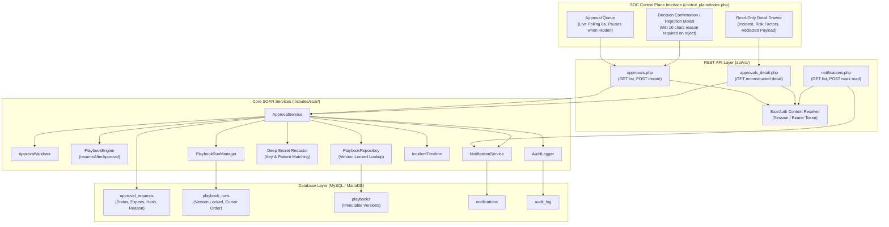

# ThreatPulse SOAR: Approval & Response Control Plane Architecture Specification

> **SCOPE:** Phase 7 implements the human-in-the-loop SOC Approval & Response Control Plane. It provides an intuitive, high-assurance web interface and REST APIs for inspecting and deciding on privileged actions. It adheres strictly to the non-destructive boundary: `BLOCK_IP`, `ISOLATE_HOST`, `DISABLE_USER`, and `KILL_PROCESS` remain deliberately absent until Phase 8.

---

## 1. Executive Summary & Design Principles

The ThreatPulse SOC Approval & Response Control Plane bridges deterministic automated playbook orchestration (Phase 6) and human SOC oversight. When a playbook encounters a privileged or sensitive step (`REQUEST_APPROVAL`), execution pauses in an immutable `WAITING_APPROVAL` state, persisting an execution cursor and generating a cryptographic hash of the action payload.

The Phase 7 Control Plane enforces five non-negotiable security principles:

1. **Server as the Sole Authorization Boundary:** Frontend UI controls, disabled buttons, and client-side JavaScript checks are UX affordances only. All access, permissions, and state transitions are strictly validated on the backend via canonical `SoarAuth` RBAC.
2. **Anti-Tampering & Minimal Client Inputs:** Decision requests accept only `approval_id`, `decision`, and an optional/required `reason`. Client attempts to supply authoritative values (such as `risk_score`, `priority`, `incident_id`, or `action_parameters`) are detected and rejected.
3. **True Playbook Version Locking:** Every playbook run captures and persists the exact version of the playbook definition resolved at creation. Resumption after approval loads that immutable version and never silently resolves "latest".
4. **Deep Secret Redaction:** Approval detail inspection is a read-only security context. Sensitive parameters (passwords, tokens, API keys, Bearer headers, cookies, private keys) are recursively redacted before reaching the browser.
5. **Strict Audit & Timeline Semantics:** Inspection events (`APPROVAL_VIEWED`) are cleanly separated from state transitions (`APPROVAL_APPROVED`, `APPROVAL_REJECTED`). Duplicate or replayed requests never generate duplicate state changes or timeline events.

---

## 2. Architecture Overview



---

## 3. Strict 15-Step Server-Side Approval Decision Workflow

Every approval or rejection decision processed via `POST /api/v1/approvals.php` executes the following sequence:

```
 1. Authenticate Request
    └── Resolve actor identity and tier via SoarAuth::getContext($pdo) from session or Bearer token.
 2. Validate Request Syntax
    └── Require approval_id, decision ('APPROVE' or 'REJECT'). If REJECT, require reason (10–1000 chars, HTML stripped).
        Assert no forbidden client fields (risk_score, priority, incident_id, etc.). Validate CSRF token for web sessions.
 3. Resolve Approval Record
    └── Query approval_requests by approval_id. Throw 404 if not found.
 4. Authorize Access to Approval
    └── Verify user possesses 'view_incidents' capability.
 5. Lock Approval Row / Concurrency Check
    └── Enforce single-consumer concurrency guard via atomic SQL rowCount guard.
 6. Verify Approval State is PENDING
    └── Reject transitions from terminal states (APPROVED, REJECTED, EXPIRED, CANCELLED).
 7. Verify Authoritative Server Time
    └── Compare expires_at against server-authoritative time(). Throw 400 if expired.
 8. Resolve Authoritative Action Payload
    └── Fetch action payload and cursor step parameters from database records.
 9. Recalculate Payload Hash
    └── Calculate SHA-256 hash of authoritative parameter payload.
10. Compare Against Stored Hash
    └── Use timing-safe hash_equals($storedHash, $computedHash). Reject on mismatch.
11. Verify Approval Authority via SoarAuth
    └── Verify reviewer possesses 'approve_actions' permission AND meetsMinimumTier($reviewerTier, $requiredTier).
12. Perform State Transition Atomically
    └── Execute UPDATE approval_requests SET status=?, decided_by=?, decided_at=NOW(), rejection_reason=?
        WHERE id=? AND status='PENDING' AND expires_at > NOW(). Verify exactly 1 row affected.
13. Resume or Terminate Playbook Execution
    └── If APPROVED: PlaybookEngine::resumeAfterApproval() resumes execution from cursor step.
        If REJECTED: PlaybookRunManager transitions run to FAILED with rejection reason.
14. Record Audit, Timeline, and Notification Records Transactionally
    └── Emit APPROVAL_APPROVED or APPROVAL_REJECTED to audit_log.
        Emit timeline milestone to incident_timeline.
        Send in-app notification to the analyst who initiated or is assigned to the run.
15. Return Safe Response
    └── Output JSON response containing only safe operational identifiers (approval_id, status, run_id).
```

---

## 4. State Machine & Terminal Invariants

The approval lifecycle is governed by an explicit state transition matrix:

| Current State | Target State | Permitted? | Transition Trigger |
| :--- | :--- | :---: | :--- |
| `PENDING` | `APPROVED` | **YES** | Authorized analyst grants approval before expiration |
| `PENDING` | `REJECTED` | **YES** | Authorized analyst rejects approval with valid reason |
| `PENDING` | `EXPIRED` | **YES** | System cleanup or decision attempt past `expires_at` |
| `PENDING` | `CANCELLED` | **YES** | Incident closed or playbook run cancelled |
| `APPROVED` | *Any* | **NO** | Terminal state. Replay attempts return 400 / 409 error |
| `REJECTED` | *Any* | **NO** | Terminal state. Cannot be reopened or re-approved |
| `EXPIRED` | *Any* | **NO** | Terminal state. Expired approvals cannot be revived |
| `CANCELLED` | *Any* | **NO** | Terminal state. Cannot transition |

---

## 5. Playbook Version Locking Mechanism

### Problem Addressed
In dynamic environments, SOC engineers update playbook definitions (e.g. adding new enrichment steps or altering thresholds). If an active execution run that is paused waiting for human approval resumes against a modified "latest" definition, it can experience cursor corruption, step order mismatch, or execution of unapproved actions.

### Architecture Solution
ThreatPulse enforces strict immutable version locking:

1. **Version Declaration:** Every playbook definition in the `playbooks` table contains an integer `version` (default 1) and an active flag. A composite unique key `uq_playbook_name_version (playbook_name, version)` prevents duplicate versions.
2. **Run Initialization:** When `PlaybookRunManager::createRun()` creates an execution record, it captures the current `playbooks.version` and stores it directly into `playbook_runs.playbook_version`.
3. **Execution & Resumption:** `PlaybookEngine::resumeAfterApproval()` loads the playbook definition strictly via the foreign key `$run['playbook_id']`. It **never** executes a lookup for `active=1` or "latest" version for an existing run.
4. **Publishing New Versions:** Publishing a revised playbook inserts a new row with `version = N + 1`. Existing runs continue executing against their locked version `N` without disruption.

---

## 6. Deep Secret Redaction Engine

When analysts inspect pending approvals via `GET /api/v1/approvals_detail.php`, sensitive credentials must be redacted to prevent token exfiltration and shoulder surfing.

ThreatPulse implements a multi-layer recursive redaction engine:

### 1. Key-Pattern Redaction
Any dictionary or object key matching the case-insensitive pattern below has its value replaced with `[REDACTED]`:
```regex
/(?:password|passwd|pwd|api_key|apikey|token|secret|auth|authorization|credentials|bearer|cookie|cookies|private_key|privkey|certificate|cert|session|session_id)/i
```

### 2. Value-Pattern Redaction
String values in non-sensitive key containers are inspected using deterministic regular expressions:
- **Bearer Tokens:** `Bearer [a-zA-Z0-9_\-\.]{16,}` $\rightarrow$ `Bearer [REDACTED]`
- **Private Keys:** `-----BEGIN[A-Z0-9_\s\-]+PRIVATE KEY-----` $\rightarrow$ `[REDACTED PRIVATE KEY]`
- **Basic Auth Headers:** `Basic [a-zA-Z0-9+\/=]{16,}` $\rightarrow$ `Basic [REDACTED]`

### Limitation Notice
While this regex-based redaction covers standard token formats and credentials, proprietary, unstructured, or custom-formatted secrets embedded in plain text cannot be guaranteed to be caught. SOC administrators must avoid placing raw production secrets in playbook parameter definitions.

---

## 7. Audit & Timeline Distinction

To ensure forensic integrity and prevent audit log bloating:

- **`APPROVAL_VIEWED`:** Recorded in `audit_log` whenever an analyst opens the detail inspection modal. This is a read-only audit entry. It does **not** modify approval status, does **not** update playbook cursor, and does **not** emit an incident timeline milestone.
- **`APPROVAL_APPROVED` / `APPROVAL_REJECTED`:** Recorded in `audit_log` **only** upon a successful atomic database state transition.
- **Incident Timeline:** `APPROVAL_GRANTED` and `APPROVAL_REJECTED` milestones are emitted to `incident_timeline` solely when a valid transition occurs. If a request is retried or replayed, the second request fails at the state machine validation layer and no duplicate timeline milestones are created.

---

## 8. Real-Time Polling Strategy & Page Visibility Control

Rather than introducing heavyweight infrastructure (WebSockets, Server-Sent Events, or Redis pub/sub), Phase 7 utilizes a lightweight, resilient client polling architecture:

- **Polling Interval:** The UI polls `/api/v1/approvals.php` and `/api/v1/notifications.php` every **8 seconds**.
- **Page Visibility API (`document.hidden`):** When the analyst switches tabs or minimizes the window, the `visibilitychange` event listener immediately pauses the polling timer. Polling resumes with an immediate fresh fetch when the tab returns to focus.
- **Rate Limiting:** Both endpoints are protected by `RateLimiter::check()`, enforcing a ceiling of 120 requests per minute per IP to prevent accidental denial of service.

---

## 9. Non-Destructive Boundary Verification

Phase 7 maintains the strict non-destructive boundary established in Phase 6:
- **No Privileged Response Drivers:** `BLOCK_IP`, `ISOLATE_HOST`, `DISABLE_USER`, and `KILL_PROCESS` are **not** registered in `ActionRegistry`.
- **No Dynamic Code Execution:** Codebase audit verifies complete absence of `eval()`, `exec()`, `shell_exec()`, `system()`, `passthru()`, `proc_open()`, or dynamic includes.
- **Safe Testing:** All Phase 6 and Phase 7 test suites execute with zero destructive side-effects and zero database corruption risks.

Phase 8 will introduce privileged containment drivers under this exact control plane, requiring explicit LEAD/ADMIN approval, payload hash verification, and pre-execution dry-run validation.
