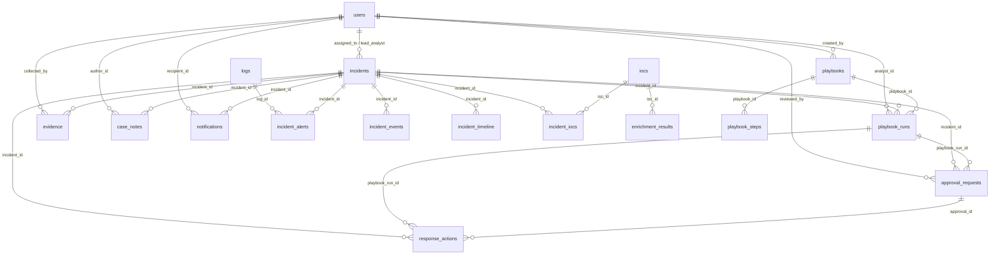

# ThreatPulse SOAR Database Architecture & Schema Specification

## 1. Executive Summary & Architectural Philosophy

The ThreatPulse platform extends a live Blue Team SIEM into an integrated **SIEM + SOAR (Security Orchestration, Automation, and Response)** platform.

To maintain continuous operational stability for existing SIEM dashboards, telemetry ingest pipelines, and forensic investigative tools, the SOAR database subsystem adheres to the following core architectural rules:

1. **100% Additive Design**: Zero existing tables, columns, indexes, or types are modified, renamed, or deleted.
2. **Decoupled Alert-to-Incident Hierarchy**: Raw events and SIEM alerts remain in their original structures. Incidents aggregate alerts through a dedicated many-to-many junction table (`incident_alerts`), rather than polluting the high-volume `logs` table with incident pointers.
3. **Strict Data-Only Playbook Modeling**: Playbook definitions, triggers, and parameters are stored strictly as **static JSON schema data**. No executable PHP, shell scripts, SQL queries, or arbitrary code expressions are permitted within database fields.
4. **Append-Oriented Auditing**: Incident timelines (`incident_timeline`), approvals (`approval_requests`), and response actions (`response_actions`) function as append-only audit trails to preserve forensic integrity and chain of custody.

---

## 2. Entity-Relationship Model



---

## 3. Detailed Entity Catalog (15 SOAR Tables)

### 3.1 `incidents`
Represents the top-level case management record aggregating alerts, timeline events, evidence, and response actions.
- **Primary Key**: `id` (BIGINT UNSIGNED AUTO_INCREMENT)
- **Unique Constraints**: `uq_incidents_number` (`incident_number`)
- **Foreign Keys**:
  - `assigned_to` -> `users(id)` ON DELETE SET NULL
  - `lead_analyst` -> `users(id)` ON DELETE SET NULL
- **State Machine**:
  - `status`: `NEW` -> `OPEN` -> `INVESTIGATING` -> `CONTAINED` -> `RESOLVED` -> `CLOSED`
  - `severity`: `CRITICAL`, `HIGH`, `MEDIUM`, `LOW`, `INFO`
  - `priority`: `P1`, `P2`, `P3`, `P4`
- **Key Indexes**: `status`, `severity`, `priority`, `created_at`, `assigned_to`, `attack_category`.

### 3.2 `incident_alerts`
Many-to-Many junction linking legacy SIEM alerts from `logs` to an `incident`.
- **Primary Key**: `id` (BIGINT UNSIGNED AUTO_INCREMENT)
- **Unique Constraints**: `uq_incident_alerts` (`incident_id`, `log_id`)
- **Foreign Keys**:
  - `incident_id` -> `incidents(id)` ON DELETE CASCADE
  - `log_id` -> `logs(id)` ON DELETE CASCADE
- **Key Indexes**: `incident_id`, `log_id`.

### 3.3 `incident_events`
Stores raw telemetry event associations (e.g. WAF captures, auth logs, Apache errors) with unstructured JSON payloads.
- **Primary Key**: `id` (BIGINT UNSIGNED AUTO_INCREMENT)
- **Foreign Keys**: `incident_id` -> `incidents(id)` ON DELETE CASCADE
- **Key Indexes**: `incident_id`, `event_timestamp`, `raw_event_id`.

### 3.4 `incident_timeline`
Append-only chronological audit log of all incident milestones, status changes, and playbook operations.
- **Primary Key**: `id` (BIGINT UNSIGNED AUTO_INCREMENT)
- **Foreign Keys**: `incident_id` -> `incidents(id)` ON DELETE CASCADE
- **Event Types**: `ALERT_ADDED`, `STATUS_CHANGE`, `SEVERITY_CHANGE`, `PLAYBOOK_STARTED`, `PLAYBOOK_STEP`, `APPROVAL_REQUESTED`, `APPROVAL_GRANTED`, `APPROVAL_REJECTED`, `ACTION_EXECUTED`, `EVIDENCE_ATTACHED`, `NOTE_ADDED`.
- **Actors**: `SYSTEM`, `ANALYST`, `PLAYBOOK`.
- **Key Indexes**: `incident_id`, `created_at`, `event_type`.

### 3.5 `iocs`
Centralized indicator of compromise catalog tracking global reputation and attribution.
- **Primary Key**: `id` (BIGINT UNSIGNED AUTO_INCREMENT)
- **Unique Constraints**: `uq_iocs_type_value` (`ioc_type`, `ioc_value`)
- **Types Supported**: `IPV4`, `IPV6`, `DOMAIN`, `URL`, `MD5`, `SHA256`, `EMAIL`.
- **Key Indexes**: `ioc_type`, `ioc_value(255)`, `reputation_score`, `expires_at`.

### 3.6 `incident_iocs`
Junction mapping indicators to an incident with specific threat contextual roles (`ATTACKER`, `TARGET`, `C2_SERVER`, `PAYLOAD_URL`, `DROPPED_FILE`, `EXFILTRATION_HOST`).
- **Primary Key**: `id` (BIGINT UNSIGNED AUTO_INCREMENT)
- **Unique Constraints**: `uq_incident_iocs` (`incident_id`, `ioc_id`)
- **Foreign Keys**:
  - `incident_id` -> `incidents(id)` ON DELETE CASCADE
  - `ioc_id` -> `iocs(id)` ON DELETE CASCADE
- **Key Indexes**: `incident_id`, `ioc_id`, `role`.

### 3.7 `enrichment_results`
Caches external threat intelligence lookups (IP-API, AbuseIPDB, VirusTotal, ThreatFox, WHOIS) to minimize external API costs and prevent rate limiting.
- **Primary Key**: `id` (BIGINT UNSIGNED AUTO_INCREMENT)
- **Foreign Keys**: `ioc_id` -> `iocs(id)` ON DELETE CASCADE
- **Status**: `SUCCESS`, `FAILED`, `RATE_LIMITED`.
- **Key Indexes**: `(ioc_id, provider)`, `cached_until`.

### 3.8 `playbooks`
Declarative workflow templates defining containment, enrichment, investigation, and remediation procedures.
- **Primary Key**: `id` (BIGINT UNSIGNED AUTO_INCREMENT)
- **Unique Constraints**: `uq_playbooks_name` (`playbook_name`)
- **Foreign Keys**: `created_by` -> `users(id)` ON DELETE SET NULL
- **Governance**: `requires_approval` (BOOLEAN), `min_approval_tier` (`TIER1`, `TIER2`, `LEAD`, `ADMIN`).
- **Key Indexes**: `category`, `trigger_type`, `is_active`.

### 3.9 `playbook_steps`
Ordered execution graph steps for a playbook definition.
- **Primary Key**: `id` (BIGINT UNSIGNED AUTO_INCREMENT)
- **Unique Constraints**: `uq_playbook_step_order` (`playbook_id`, `step_order`)
- **Foreign Keys**: `playbook_id` -> `playbooks(id)` ON DELETE CASCADE
- **Key Indexes**: `playbook_id`.

### 3.10 `playbook_runs`
Runtime execution instances of a playbook against a case or alert.
- **Primary Key**: `id` (BIGINT UNSIGNED AUTO_INCREMENT)
- **Unique Constraints**: `uq_playbook_runs_uuid` (`run_uuid`)
- **Foreign Keys**:
  - `playbook_id` -> `playbooks(id)` ON DELETE RESTRICT
  - `incident_id` -> `incidents(id)` ON DELETE CASCADE
  - `analyst_id` -> `users(id)` ON DELETE SET NULL
- **Status**: `PENDING`, `RUNNING`, `WAITING_APPROVAL`, `COMPLETED`, `FAILED`, `CANCELLED`.
- **Key Indexes**: `status`, `incident_id`, `playbook_id`, `started_at`.

### 3.11 `approval_requests`
Human-in-the-Loop (HITL) gatekeeping requests required prior to executing privileged containment actions.
- **Primary Key**: `id` (BIGINT UNSIGNED AUTO_INCREMENT)
- **Foreign Keys**:
  - `playbook_run_id` -> `playbook_runs(id)` ON DELETE CASCADE
  - `incident_id` -> `incidents(id)` ON DELETE CASCADE
  - `reviewed_by` -> `users(id)` ON DELETE SET NULL
- **Status**: `PENDING`, `APPROVED`, `REJECTED`, `EXPIRED`.
- **Key Indexes**: `status`, `incident_id`, `playbook_run_id`, `expires_at`.

### 3.12 `response_actions`
Audit and execution record of atomic mitigation actions dispatched to defensive infrastructure.
- **Primary Key**: `id` (BIGINT UNSIGNED AUTO_INCREMENT)
- **Unique Constraints**: `uq_response_actions_uuid` (`action_uuid`)
- **Foreign Keys**:
  - `incident_id` -> `incidents(id)` ON DELETE SET NULL
  - `playbook_run_id` -> `playbook_runs(id)` ON DELETE SET NULL
  - `approval_id` -> `approval_requests(id)` ON DELETE SET NULL
- **Status**: `QUEUED`, `IN_PROGRESS`, `SUCCESS`, `FAILED`, `ROLLED_BACK`.
- **Key Indexes**: `status`, `incident_id`, `playbook_run_id`, `approval_id`, `dispatched_at`.

### 3.13 `evidence`
Forensic evidence artifacts attached to an incident with cryptographic SHA-256 validation.
- **Primary Key**: `id` (BIGINT UNSIGNED AUTO_INCREMENT)
- **Foreign Keys**:
  - `incident_id` -> `incidents(id)` ON DELETE CASCADE
  - `collected_by` -> `users(id)` ON DELETE SET NULL
- **Types**: `LOG_SNIPPET`, `NETWORK_PCAP`, `FILE_HASH`, `MEMORY_DUMP_META`, `HTTP_REQUEST_PAYLOAD`, `SCREENSHOT`.
- **Key Indexes**: `incident_id`, `evidence_type`, `data_hash`, `collected_at`.

### 3.14 `case_notes`
Analyst investigation scratchpad and collaboration notes per incident.
- **Primary Key**: `id` (BIGINT UNSIGNED AUTO_INCREMENT)
- **Foreign Keys**:
  - `incident_id` -> `incidents(id)` ON DELETE CASCADE
  - `author_id` -> `users(id)` ON DELETE CASCADE
- **Key Indexes**: `incident_id`, `author_id`, `created_at`.

### 3.15 `notifications`
Real-time alerting queue for analysts regarding approvals, assignments, and SLA breaches.
- **Primary Key**: `id` (BIGINT UNSIGNED AUTO_INCREMENT)
- **Foreign Keys**:
  - `recipient_id` -> `users(id)` ON DELETE CASCADE
  - `incident_id` -> `incidents(id)` ON DELETE CASCADE
- **Types**: `APPROVAL_REQUIRED`, `INCIDENT_ASSIGNED`, `PLAYBOOK_FAILED`, `SLA_BREACH`.
- **Key Indexes**: `(recipient_id, is_read)`, `created_at`.

---

## 4. Query Performance & Indexing Design

1. **High-Frequency Lookups**:
   - `iocs`: Composite unique index on `(ioc_type, ioc_value)` and secondary prefix index on `ioc_value(255)` ensure O(1) exact-match lookups during threat intelligence correlation.
   - `enrichment_results`: Composite index on `(ioc_id, provider)` guarantees sub-millisecond retrieval of cached external reputation data.
2. **Dashboard Query Optimization**:
   - `incidents`: Explicit indexes on `status`, `severity`, `priority`, and `created_at` ensure case filtering and pagination queries execute without full table scans.
   - `approval_requests`: Indexes on `status` and `expires_at` enable rapid polling of active pending requests by the SOC notification engine.
3. **Cascading Integrity**:
   - Child junction tables (`incident_alerts`, `incident_iocs`, `incident_timeline`, `case_notes`, `evidence`) utilize `ON DELETE CASCADE` linked to `incidents`, guaranteeing atomic cleanup if a test or invalid case is purged.

---

## 5. Security Model & Data Integrity Safeguards

1. **Zero Raw Code in Playbooks**:
   - Fields `trigger_condition`, `action_parameters`, and `execution_context` use native JSON schemas. The application layer interprets these values strictly as data parameters for hardcoded driver methods (e.g. `FirewallDriver::blockIp($ip)`).
2. **Append-Only Incident Timeline**:
   - `incident_timeline` is written exclusively via `INSERT`. No `UPDATE` or `DELETE` endpoints will ever be exposed at the API or application layer.
3. **No Plaintext Secrets**:
   - External provider API keys and integration webhook secrets are never stored in `enrichment_results` or `playbooks`. They are resolved via environment variables or encrypted credential vaults.
4. **Idempotency & Race Protection**:
   - `run_uuid` on `playbook_runs` and `action_uuid` on `response_actions` enforce distributed idempotency, preventing accidental double-execution of containment actions.

---

## 6. Migration & Verification Instructions

### 6.1 Applying the Migration
Execute the migration against the MariaDB instance:
```bash
mysql -u root -p cybertech_db < database/migrations/001_create_soar_schema.sql
```

### 6.2 Verifying Schema Integrity
Run the automated schema introspection verification tool:
```bash
php database/verify_schema.php
```

### 6.3 Executing Database Test Suite
Run the test runner validating all 10 core lifecycle integration scenarios:
```bash
php database/tests/test_runner.php
```
Or execute directly via MySQL CLI:
```bash
mysql -u root -p cybertech_db < database/tests/001_soar_schema_test.sql
```

---

## 7. Future Extension Roadmap (Phases 2–12)

- **Phase 2 (Alert Ingestion)**: Map ingested threat feeds and WAF alerts to normalized events using `incident_alerts`.
- **Phase 3 (Incident Management)**: Build correlation engine to automatically group alerts into `incidents`.
- **Phase 4 (IOC Enrichment)**: Implement automated worker routines populating `enrichment_results`.
- **Phase 5 (Risk Scoring)**: Implement multi-factor mathematical scoring updating `incidents.risk_score`.
- **Phase 6 (Playbook Engine)**: Construct deterministic runner parsing `playbook_steps` and recording to `playbook_runs`.
- **Phase 7 (Human Approvals)**: Build approval portal and real-time toaster connected to `approval_requests`.
- **Phase 8 (Response Actions)**: Implement strongly-typed action drivers for firewall and session revocation.
- **Phase 9 (Evidence & Audit)**: Implement SHA-256 evidence ingestion and visual timeline views.
- **Phase 10 (SOC Dashboard)**: Unify SIEM telemetry and SOAR case metrics in the web UI.
- **Phase 11 (Simulation)**: Build attack scenarios validating end-to-end alert-to-containment pipelines.
- **Phase 12 (Hardening)**: Perform concurrency, RBAC boundary, and penetration testing.
