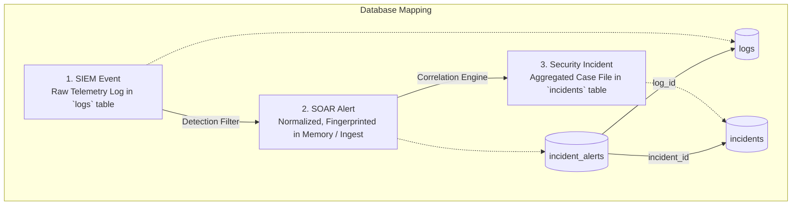
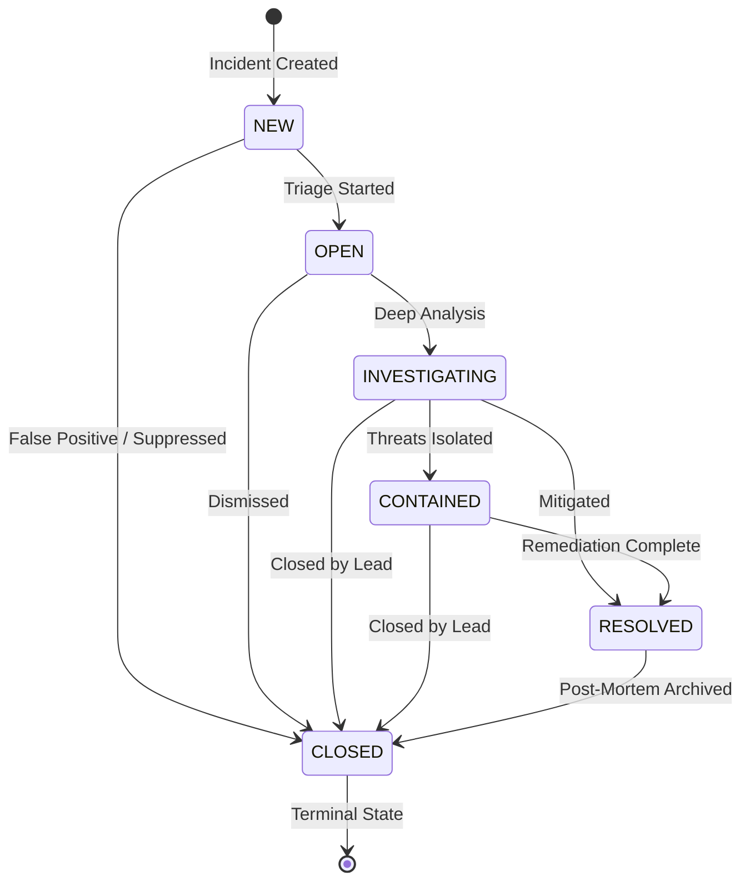

# ThreatPulse SOAR: Incident Management & Alert Correlation Specification

> **ARCHITECTURAL SCOPE & NON-GOALS:**
> **Phase 3 implements Incident Management and Rule-Based Alert Correlation.**
> It does **NOT** execute response actions, firewalls, host containment, external threat intelligence, or automated playbooks. Those capabilities belong to subsequent phases.

---

## 1. Hierarchy: Events vs. Alerts vs. Incidents

To eliminate ambiguity across the SOC operations pipeline, ThreatPulse establishes a clean three-tiered conceptual hierarchy:



1. **Event**: Raw, unverified telemetry emitted by sensors, web servers, or firewalls stored in the legacy `logs` table (e.g., a single HTTP request or SSH connection attempt).
2. **Alert**: A normalized, fingerprinted security anomaly generated by detection rules (Phase 2 canonical `AlertSchema`).
3. **Incident**: A prioritized case in `incidents` aggregating multiple related alerts, chronological timeline milestones, forensic evidence, and analyst investigation notes.

---

## 2. Incident Lifecycle & State Machine

Incidents adhere to a deterministic, non-reversible state machine governed by `IncidentStateMachine`:



### State Definitions:
- **`NEW`**: Initial state upon automated correlation or manual creation.
- **`OPEN`**: Acknowledged by SOC and assigned to an analyst for triage.
- **`INVESTIGATING`**: Active forensic analysis and scope identification in progress.
- **`CONTAINED`**: Attacking hosts blocked and compromised sessions revoked (sets `contained_at`).
- **`RESOLVED`**: Root cause mitigated, vulnerabilities patched (sets `resolved_at`).
- **`CLOSED`**: Terminal state following post-mortem sign-off (sets `closed_at`). Re-opening is prohibited in Phase 3.

---

## 3. Deterministic Correlation Engine

The `CorrelationEngine` evaluates normalized alerts against active incidents (`NEW`, `OPEN`, `INVESTIGATING`, `CONTAINED`) within a sliding lookback window (default: **2 hours / 7200s**).

### 3.1 Scoring Matrix & Weighting
Each candidate incident accumulates correlation points based on shared context:

| Rule Identifier | Evaluation Criteria | Correlation Weight |
| :--- | :--- | :---: |
| **`SAME_SOURCE_IP`** | Alert matches attacker IP on active case | **+40** |
| **`SAME_CATEGORY`** | Alert shares same attack category (e.g., `SSH`, `SQLi`) | **+20** |
| **`ATTACK_CHAIN`** | Progression across attack phases (e.g., `SSH` -> `RCE`, `SQLi` -> `RCE`) | **+30** |
| **`SAME_IOC`** | Alert contains an indicator value already tracked in the incident | **+30** |
| **`SAME_DESTINATION`** | Alert targets the same internal asset IP | **+20** |
| **`TIME_PROXIMITY`** | Alert occurs within 30 minutes of prior incident activity | **+10** |

$$\text{Correlation Threshold} \ge 50 \implies \text{Attach to Existing Incident}$$

### 3.2 Decision Contracts

#### 1. `ATTACH` (Score $\ge 50$)
The alert correlates strongly with an active case. It is linked via `incident_alerts`, and the incident severity is dynamically escalated if the new alert carries a higher severity rating.
```json
{
  "decision": "ATTACH",
  "incident_id": 101,
  "incident_number": "INC-2026-0042",
  "score": 70,
  "rules": ["SAME_SOURCE_IP", "ATTACK_CHAIN"],
  "reason": "Alert correlates with active incident INC-2026-0042 (Score: 70, Rules: SAME_SOURCE_IP, ATTACK_CHAIN)"
}
```

#### 2. `CREATE` (Uncorrelated High/Critical or Correlated Medium)
The alert represents a significant security event with no matching active incident. A new incident is generated with an intelligent, category-derived title.
```json
{
  "decision": "CREATE",
  "incident_id": null,
  "score": 0,
  "rules": [],
  "reason": "High-severity (CRITICAL) alert qualifies for new incident creation.",
  "suggested_title": "Remote Code Execution Activity from 198.51.100.50"
}
```

#### 3. `IGNORE` (Low-Value / Isolated Informational Events)
Isolated `INFO` and `LOW` alerts do not warrant incident creation and remain in the SIEM log stream for historical querying.
```json
{
  "decision": "IGNORE",
  "incident_id": null,
  "score": 0,
  "rules": [],
  "reason": "Isolated INFO alert does not meet threshold for incident creation; retained in SIEM stream."
}
```

---

## 4. Severity Escalation & Priority Mapping

### 4.1 Severity Derivation & Dynamic Escalation
An incident's severity reflects the **highest severity** among all associated alerts:

$$\text{Incident Severity} = \max(\text{Alert}_1, \text{Alert}_2, \dots, \text{Alert}_n)$$

If an incident starts as `MEDIUM` and subsequent correlation attaches a `CRITICAL` alert (e.g., an RCE exploit following brute-force attempts), the incident severity automatically escalates to `CRITICAL`, emitting a `SEVERITY_CHANGE` timeline milestone.

### 4.2 Deterministic Priority Mapping
| Highest Contributing Severity | Incident Priority | Target SLA Triage |
| :--- | :---: | :---: |
| **`CRITICAL`** | **`P1`** | `< 15 minutes` |
| **`HIGH`** | **`P2`** | `< 1 hour` |
| **`MEDIUM`** | **`P3`** | `< 4 hours` |
| **`LOW`** | **`P4`** | `< 24 hours` |
| **`INFO`** | **`P4`** | Next business day |

---

## 5. Append-Only Incident Timeline (`IncidentTimeline`)

All lifecycle mutations write timestamped entries to `incident_timeline`. Updates and deletes are prohibited:

```json
[
  {
    "event_type": "STATUS_CHANGE",
    "actor_type": "SYSTEM",
    "actor_name": "CorrelationEngine",
    "summary": "Incident INC-2026-0001 created with status NEW",
    "created_at": "2026-08-25 10:01:00"
  },
  {
    "event_type": "ALERT_ADDED",
    "actor_type": "SYSTEM",
    "actor_name": "CorrelationEngine",
    "summary": "Initial alert #1840 associated with incident",
    "details": {"log_id": 1840, "correlation_rule": "INITIAL_ALERT"},
    "created_at": "2026-08-25 10:01:00"
  },
  {
    "event_type": "ALERT_ADDED",
    "actor_type": "SYSTEM",
    "actor_name": "CorrelationEngine",
    "summary": "Alert #1842 attached via rule SAME_SOURCE_IP+ATTACK_CHAIN",
    "details": {"log_id": 1842, "rule": "SAME_SOURCE_IP+ATTACK_CHAIN"},
    "created_at": "2026-08-25 10:05:00"
  },
  {
    "event_type": "SEVERITY_CHANGE",
    "actor_type": "SYSTEM",
    "actor_name": "CorrelationEngine",
    "summary": "Severity escalated from HIGH to CRITICAL due to attached alert #1842",
    "created_at": "2026-08-25 10:05:00"
  },
  {
    "event_type": "STATUS_CHANGE",
    "actor_type": "ANALYST",
    "actor_name": "lead_analyst",
    "summary": "Status changed from OPEN to INVESTIGATING: Assigned to analyst_bob",
    "created_at": "2026-08-25 10:12:00"
  }
]
```

---

## 6. Authorization & RBAC Permissions (`SoarAuth`)

| Capability | Tier 1 (Junior) | Tier 2 (Senior Analyst) | Lead (SOC Lead) | Admin |
| :--- | :---: | :---: | :---: | :---: |
| **View Incidents & Alerts** |  Yes |  Yes |  Yes |  Yes |
| **Add Investigation Notes** |  Yes |  Yes |  Yes |  Yes |
| **Create Incidents / Manual Escalate** | No |  Yes |  Yes |  Yes |
| **Attach SIEM Alerts** | No |  Yes |  Yes |  Yes |
| **Assign Incident to Analyst** | No |  Yes |  Yes |  Yes |
| **Progress Status (NEW -> OPEN -> INV)** | No |  Yes |  Yes |  Yes |
| **Close Incidents (`CLOSED`)** | No | No |  Yes |  Yes |
| **Override Incident Severity** | No | No |  Yes |  Yes |

---

## 7. REST API Endpoints

### 7.1 `GET /api/v1/incidents.php`
- **Query Filters**: `status`, `severity`, `priority`, `assigned_to`, `category`, `created_after`, `created_before`, `limit`, `offset`.
- **Response**: Paginated list of incidents with associated alert counts.

### 7.2 `POST /api/v1/incidents.php`
- **Manual Escalation from SIEM Log**:
  ```json
  {
    "log_id": 1842,
    "title": "Suspected Brute Force Compromise",
    "description": "Manually escalated from SIEM dashboard alert #1842"
  }
  ```

### 7.3 `GET /api/v1/incidents_detail.php?id=123`
- **Response**: Full incident record, attached SIEM logs, complete chronological timeline, linked IOCs, and assigned analyst details.

### 7.4 `POST /api/v1/incidents_detail.php`
- **Status Mutation**:
  ```json
  {
    "id": 123,
    "action": "change_status",
    "new_status": "INVESTIGATING",
    "reason": "Confirmed unauthorized SSH login; reviewing auth logs"
  }
  ```
- **Analyst Assignment**:
  ```json
  {
    "id": 123,
    "action": "assign",
    "analyst_id": 2
  }
  ```

---

## 8. Complete Multi-Stage Attack Scenarios

### Scenario 1: SSH Brute Force $\to$ Successful Auth $\to$ RCE
1. **10:01:00**: Ingests `ALERT SSH password spray from 198.51.100.25` (`HIGH`, `SSH`).
   - *Correlation*: No active case. `CorrelationEngine` decides **`CREATE`**.
   - *Result*: Creates `INC-2026-0001` (*"Possible SSH Compromise from 198.51.100.25"*), severity `HIGH`, priority `P2`.
2. **10:02:30**: Ingests second `ALERT SSH authentication failure from 198.51.100.25`.
   - *Correlation*: Matches `INC-2026-0001` (`SAME_SOURCE_IP` + `SAME_CATEGORY` = 60 pts $\ge 50$). Decides **`ATTACH`**.
   - *Result*: Links alert to `INC-2026-0001`. Adds `ALERT_ADDED` to timeline.
3. **10:05:00**: Ingests `ALERT RCE whoami executed by www-data from 198.51.100.25` (`CRITICAL`, `RCE`).
   - *Correlation*: Matches `INC-2026-0001` (`SAME_SOURCE_IP` + `ATTACK_CHAIN` + `TIME_PROXIMITY` = 80 pts). Decides **`ATTACH`**.
   - *Result*: Links alert to `INC-2026-0001`. **Escalates incident severity from `HIGH` to `CRITICAL`** and priority from `P2` to `P1`. Adds `SEVERITY_CHANGE` to timeline.

---

### Scenario 2: SQL Injection $\to$ Web Shell Upload $\to$ RCE
1. **11:00:00**: Ingests `ALERT SQLi UNION SELECT from 203.0.113.80` (`HIGH`, `SQLi`).
   - *Result*: Creates `INC-2026-0002` (*"SQL Injection Campaign from 203.0.113.80"*), severity `HIGH`.
2. **11:15:00**: Ingests `ALERT RCE cmd.exe executed from 203.0.113.80` (`CRITICAL`, `RCE`).
   - *Correlation*: Matches `INC-2026-0002` (`SAME_SOURCE_IP` + `ATTACK_CHAIN` = 70 pts).
   - *Result*: Attaches alert to `INC-2026-0002`. Escalates severity to `CRITICAL` (`P1`).

---

### Scenario 3: Isolated Informational Telemetry (No Incident Created)
1. **12:00:00**: Ingests `INFO` NTP time synchronization from internal host `192.168.1.10`.
   - *Correlation*: Severity `INFO`. No active matching case.
   - *Result*: Decides **`IGNORE`**. Retained in `logs` table; **zero incidents created**.
