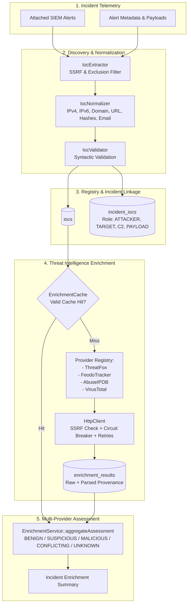
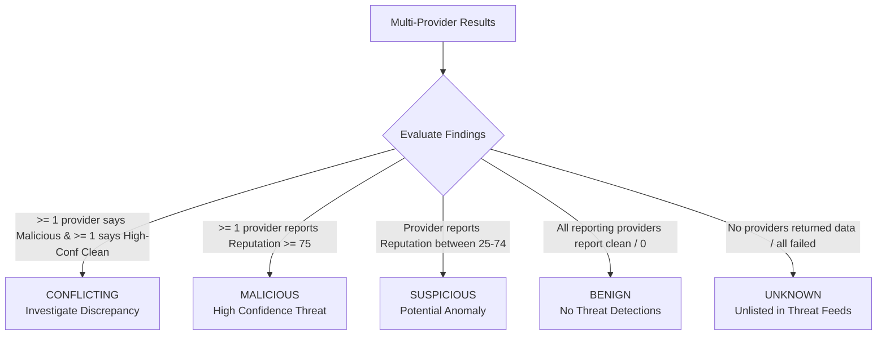

# ThreatPulse SOAR: IOC Management & Threat Intelligence Enrichment Specification

> **ARCHITECTURAL SCOPE & NON-GOALS:**
> **Phase 4 implements IOC Extraction, Normalization, Multi-Provider Threat Intelligence Enrichment, and Caching.**
> It does **NOT** calculate incident-level risk scores, execute playbooks, modify firewalls, isolate hosts, or perform automated remediation. Those capabilities belong to subsequent phases.

---

## 1. Subsystem Architecture



---

## 2. Supported IOC Types & Canonical Normalization Rules

ThreatPulse SOAR supports 7 standard IOC types stored in the `iocs` table:

| IOC Type | Canonical Normalization Rule | Example Input $\to$ Canonical Output |
| :--- | :--- | :--- |
| **`IPV4`** | Formatted via `inet_ntop(inet_pton($ip))` (strips leading zeros) | `198.51.100.025` $\to$ `198.51.100.25` |
| **`IPV6`** | Compressed lowercase zero-group notation via `inet_ntop` | `2001:0DB8:0000::0001` $\to$ `2001:db8::1` |
| **`DOMAIN`** | Lowercase string, trims trailing dot, enforces RFC 1035 syntax | `Malicious-C2.Example.NET.` $\to$ `malicious-c2.example.net` |
| **`URL`** | Lowercases scheme & host, preserves path/query, limits to HTTP/HTTPS | `HTTPS://Bad.COM:8080/c2?k=1` $\to$ `https://bad.com:8080/c2?k=1` |
| **`MD5`** | Lowercase 32-character hexadecimal string | `44D88612FEA8A8F3...` $\to$ `44d88612fea8a8f3...` |
| **`SHA256`**| Lowercase 64-character hexadecimal string | `E3B0C44298FC1C14...` $\to$ `e3b0c44298fc1c14...` |
| **`EMAIL`** | Lowercases domain part, preserves local part | `Attacker@Evil-Domain.COM` $\to$ `Attacker@evil-domain.com` |

---

## 3. Extraction & Security Exclusions (`IocExtractor`)

`IocExtractor` inspects `source_ip`, `destination_ip`, `ioc_value`, message text, and metadata while strictly filtering out internal or harmless artifacts:

### Automatic Exclusions:
1. **RFC 1918 Private Addresses**: `10.0.0.0/8`, `172.16.0.0/12`, `192.168.0.0/16` (preventing internal host enrichment against external feeds).
2. **Loopback Addresses**: `127.0.0.0/8`, `::1`, `localhost`.
3. **Cloud Metadata Endpoints**: `169.254.169.254`, `metadata.google.internal`, `169.254.0.0/16`.
4. **Special Use / Multicast**: `0.0.0.0`, `255.255.255.255`, `224.0.0.0/4`, `fe80::/10`, `fc00::/7`.
5. **Example & Documentation Domains**: `example.com`, `example.org`, `test.local`, `invalid`.

---

## 4. Threat Intelligence Provider Capabilities

Threat intelligence providers are integrated via the common `ThreatIntelProvider` interface and registered in `ThreatIntelProviderRegistry`:

| Provider | Supported IOC Types | Query Protocol | Rate Limits |
| :--- | :--- | :--- | :--- |
| **ThreatFox** (`abuse.ch`) | `IPV4`, `DOMAIN`, `URL`, `MD5`, `SHA256` | POST JSON (`search_ioc`) | 60 req/min |
| **Feodo Tracker** (`abuse.ch`)| `IPV4` | GET JSON blocklist | 30 req/min |
| **AbuseIPDB** | `IPV4`, `IPV6` | GET REST API (`v2/check`) | 60 req/min |
| **VirusTotal** | `IPV4`, `DOMAIN`, `URL`, `MD5`, `SHA256` | GET REST API (`v3`) | 4 req/min (free tier) |

---

## 5. Caching Policies & Provenance

To prevent provider quota exhaustion and minimize latency, all lookups are cached in `enrichment_results`:

| IOC Category | Default Cache TTL | Rationale |
| :--- | :---: | :--- |
| **IP Intelligence** (`IPV4`, `IPV6`) | **1 hour** (`3600s`) | Dynamic IP churn, botnet migration, DHCP reassignments |
| **Domain Intelligence** (`DOMAIN`) | **6 hours** (`21600s`) | Fast-flux DNS updates, newly registered domains |
| **URL Intelligence** (`URL`) | **6 hours** (`21600s`) | Ephemeral payload delivery URLs, phishing campaigns |
| **File Hashes** (`MD5`, `SHA256`) | **24 hours** (`86400s`) | Static cryptographic malware signatures |
| **Email Addresses** (`EMAIL`) | **24 hours** (`86400s`) | Persistent phishing sender accounts |

### Provenance Preservation:
Every cached and returned result stores:
- **`provider`**: Exact provider identity (e.g. `ThreatFox`).
- **`raw_response`**: Original unedited provider payload.
- **`parsed_summary`**: Standardized summary attributes.
- **`cached_until`**: Expiration timestamp.

---

## 6. Multi-Provider Reputation Aggregation

The `EnrichmentService` aggregates independent provider responses into a normalized assessment without destroying provider-level details:



### Assessment Definitions:
- **`MALICIOUS`**: One or more trusted providers classify the IOC with high malicious confidence ($\ge 75$).
- **`SUSPICIOUS`**: Indicators observed in low-confidence anomaly lists or low report counts ($25-74$).
- **`CONFLICTING`**: Contradictory reports (one provider flags malicious while another high-confidence provider flags explicitly clean).
- **`BENIGN`**: Consulted feeds confirm no malicious history or clean status.
- **`UNKNOWN`**: Indicator unlisted in consulted databases.

---

## 7. HTTP Client Hardening & SSRF Protections

All outbound threat intelligence communication passes through [`HttpClient`](file:///c:/Users/rishi/OneDrive/Desktop/Projects/Blue-Team-main/includes/soar/enrichment/HttpClient.php):

1. **Pre-flight DNS & IP Validation**: Target hostnames are resolved via DNS, and all resolved IPs are validated against private and cloud metadata subnets before connection.
2. **Redirect Freezing**: `CURLOPT_FOLLOWLOCATION` is disabled to prevent open-redirect SSRF bypasses.
3. **Strict Timeouts**:
   - Connection Timeout: **3 seconds**
   - Total Request Timeout: **10 seconds**
   - Max Response Body: **1 MB** (1,048,576 bytes)
4. **Circuit Breaker**:
   - `CLOSED` $\to$ `OPEN`: 3 consecutive failures trigger a 60-second cooldown.
   - `OPEN` $\to$ `HALF_OPEN`: Allows a single canary request to test provider recovery.
5. **Exponential Retries**: Up to 2 retries with backoff on transient errors (`429`, `502`, `503`, `504`, timeouts). **Zero retries** on `400`, `401`, `403`, `404`.

---

## 8. REST API Endpoints

### 8.1 `GET /api/v1/iocs.php`
- **Purpose**: Search and filter global IOC registry.
- **Filters**: `ioc_type`, `ioc_value`, `reputation`, `source_feed`, `limit`, `offset`.

### 8.2 `GET /api/v1/iocs_detail.php?id=123`
- **Purpose**: Retrieve full IOC record, linked incidents with roles, complete multi-provider enrichment history, and current aggregated assessment.

### 8.3 `POST /api/v1/incidents_enrichment.php`
- **Purpose**: Discover, attach, and enrich all IOCs associated with an incident.
- **Payload**: `{"incident_id": 123}`
- **Response**:
  ```json
  {
    "success": true,
    "action": "incident_enriched",
    "data": {
      "incident_id": 123,
      "incident_number": "INC-2026-0001",
      "total_iocs": 2,
      "attached_iocs": [
        {"ioc_id": 45, "type": "IPV4", "value": "198.51.100.25", "role": "ATTACKER"},
        {"ioc_id": 46, "type": "URL", "value": "https://c2.bad.com/stage2.bin", "role": "PAYLOAD_URL"}
      ],
      "summary": {
        "malicious_iocs": 2,
        "suspicious_iocs": 0,
        "conflicting_iocs": 0,
        "benign_iocs": 0,
        "unknown_iocs": 0
      }
    }
  }
  ```

---

## 9. Secret Management & Untrusted Data Handling

1. **Zero Secret Exposure**:
   - Provider API keys (`THREATFOX_API_KEY`, `ABUSEIPDB_API_KEY`, `VIRUSTOTAL_API_KEY`) are read strictly from environment variables.
   - Keys are **never** rendered in frontend templates, logged in `audit_log`, or returned in REST API payloads.
2. **Untrusted Provider Data**:
   - Provider responses are treated as untrusted user input.
   - Raw responses are stored in database `JSON` columns and never evaluated as executable code or directly concatenated into HTML.
