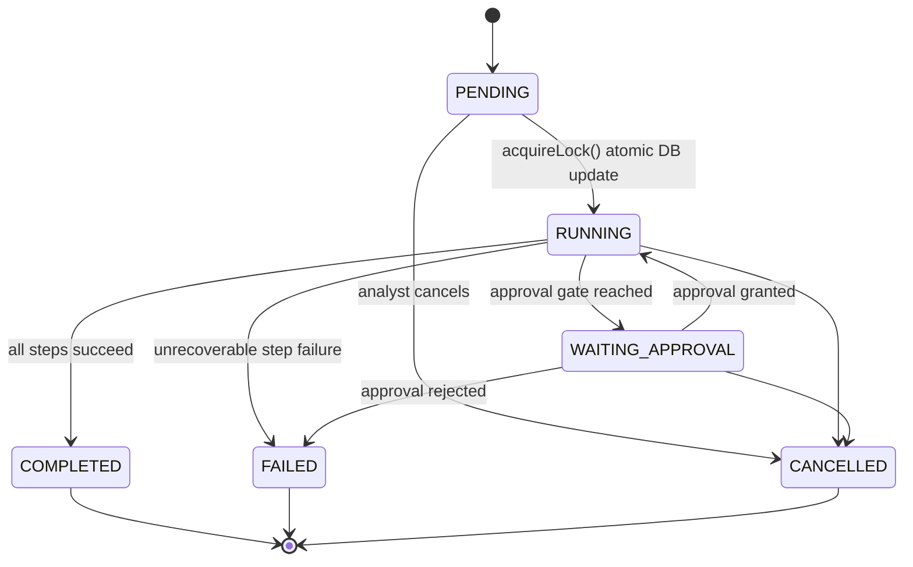

# ThreatPulse SOAR: Playbook Engine Architecture Specification

> **SCOPE:** Phase 6 implements a deterministic, auditable Playbook Engine with a fixed action allowlist. It executes ZERO destructive response actions. `BLOCK_IP`, `ISOLATE_HOST`, `DISABLE_USER`, and `KILL_PROCESS` are deliberately absent from this phase.

---

## 1. Why Arbitrary Code Execution Is Prohibited

**Playbooks are orchestration data, not executable programs.**

In ThreatPulse SOAR, a playbook stored in the database is a declarative description of *what to do*: a sequence of named, pre-validated action references. It is **never** interpreted as:

- PHP source code
- Shell script
- SQL statement
- JavaScript
- Any other executable syntax

The following functions are **structurally absent** from the entire playbook subsystem:

```
eval()         exec()         shell_exec()    system()
passthru()     popen()        proc_open()     backticks
include($var)  require($var)  new $className  call_user_func($name)
```

**The attack surface this prevents:**

| Attack Vector | Prevention |
| :--- | :--- |
| Analyst-controlled code injection | Action handler class names hard-coded in `ActionRegistry`, never read from DB |
| SQL injection via playbook fields | All queries use PDO parameterized statements; playbook fields are stored as JSON blobs |
| Shell command escalation | No shell execution functions exist anywhere in the playbook stack |
| Template expression injection | `TemplateResolver` validates every `{{token}}` against an explicit allowlist |
| IDOR incident escalation | Context loaded exclusively from authoritative DB state; client-supplied severity/risk_score ignored |

---

## 2. Playbook Architecture

```mermaid
flowchart TD
    subgraph Inputs["Analyst/System Inputs"]
        Incident[Incident + Risk Score]
        Mode["Mode: MANUAL | DRY_RUN"]
    end

    subgraph Selection["Playbook Selection"]
        Selector[PlaybookSelector<br/>Rule-Based Deterministic]
    end

    subgraph Engine["Execution Engine"]
        PBEngine[PlaybookEngine<br/>Orchestrates step loop]
        Context[PlaybookContext<br/>Immutable DB snapshot]
        Executor[PlaybookStepExecutor<br/>Validates + dispatches]
        Registry[ActionRegistry<br/>Hard-coded allowlist]
        Resolver[TemplateResolver<br/>{{var}} allowlist]
    end

    subgraph Actions["Allowlisted Action Handlers"]
        A1[ENRICH_IOCS]
        A2[COLLECT_INCIDENT_CONTEXT]
        A3[ADD_INCIDENT_NOTE]
        A4[REQUEST_APPROVAL]
        A5[NOTIFY_ANALYST]
        A6[CREATE_EVIDENCE_RECORD]
    end

    subgraph Storage["Persistence"]
        RunsTable[(playbook_runs)]
        StepResults[(playbook_step_results)]
        Approvals[(approval_requests)]
        Timeline[(incident_timeline)]
        AuditLog[(audit_log)]
    end

    Inputs --> Selection
    Selection --> PBEngine
    PBEngine --> Context
    PBEngine --> Executor
    Executor --> Registry
    Executor --> Resolver
    Registry --> A1 & A2 & A3 & A4 & A5 & A6
    PBEngine --> RunsTable
    Executor --> StepResults
    PBEngine --> Approvals
    PBEngine --> Timeline
    PBEngine --> AuditLog
```

---

## 3. Action Allowlist (Phase 6)

All six Phase 6 actions are **read-oriented and non-destructive**. No host isolation, no firewall changes, no account modifications.

| Action Type | Risk Level | Requires Approval | Retryable | Default Timeout |
| :--- | :---: | :---: | :---: | :---: |
| `ENRICH_IOCS` | LOW | No | Yes (max 1) | 30s |
| `COLLECT_INCIDENT_CONTEXT` | LOW | No | No | 15s |
| `ADD_INCIDENT_NOTE` | LOW | No | No | 10s |
| `REQUEST_APPROVAL` | MEDIUM | Yes (by definition) | No | 0s |
| `NOTIFY_ANALYST` | LOW | No | Yes (max 1) | 10s |
| `CREATE_EVIDENCE_RECORD` | LOW | No | No | 15s |

---

## 4. Template Variable Allowlist

Only these variables are resolvable in action parameter values:

| Namespace | Variables |
| :--- | :--- |
| `incident.*` | `id`, `incident_number`, `title`, `description`, `severity`, `status`, `priority`, `risk_score`, `attack_category`, `source_ip` |
| `ioc.*` | `value`, `type`, `assessment` |
| `analyst.*` | `id`, `username` |
| `run.*` | `run_uuid`, `mode` |

**Any template not on this list causes a `RuntimeException` and step failure.**

---

## 5. Playbook Run State Machine



**Invalid transitions** (e.g., `COMPLETED → RUNNING`) throw `RuntimeException`.

---

## 6. Step Lifecycle

```
Step DB row loaded
    ↓
action_type validated against ActionRegistry allowlist
    ↓
action_parameters template-resolved via TemplateResolver
    ↓
approval gate checked (if requires_approval = true)
    ↓
Handler executed (ZERO dynamic class instantiation)
    ↓
ActionResult returned (SUCCESS | FAILED | SKIPPED | WAITING_APPROVAL)
    ↓
Result logged to playbook_step_results
    ↓
Next step determined:
    Success → on_success_step (or next by order)
    Failure → on_failure_step (or FAILED run)
```

---

## 7. Branching, Retries & Timeouts

- **Branching**: Each step may specify `on_success_step` (ID) and `on_failure_step` (ID). Both references are validated against existing step IDs at definition time.
- **Loop guard**: Maximum **100 step executions** per run prevents infinite loops.
- **Retries**: Only `ENRICH_IOCS` and `NOTIFY_ANALYST` are retryable. Maximum **2 retries**. Authorization failures, validation failures, and approval rejections are **never retried**.
- **Timeouts**: Maximum per-step timeout is **300 seconds**. Timed-out steps become `FAILED` and follow the failure branch.

---

## 8. Approval Gate Model

When a `REQUEST_APPROVAL` step executes:

1. An `approval_requests` row is created with `payload_hash = SHA-256(action_payload)`.
2. The run transitions to `WAITING_APPROVAL`.
3. Execution halts until an authorized analyst resumes.

**Integrity verification on resume:**
- Approval request must be `PENDING` (not yet consumed).
- `expires_at` must be in the future (24-hour TTL by default).
- Approval is consumed atomically via `UPDATE ... WHERE status = 'PENDING'` (row count = 1 check).
- If action parameters have changed since the request was created, the `payload_hash` will not match — old approval is invalid.

**Authorization tiers for approval:**
- `TIER1`: Cannot approve any privileged action.
- `LEAD` / `ADMIN`: Can approve actions requiring `min_approval_tier = LEAD`.

---

## 9. Concurrency Protection

The `acquireLock()` method performs an atomic DB update:

```sql
UPDATE playbook_runs SET status = 'RUNNING'
WHERE id = ? AND status = 'PENDING'
```

Only the writer whose `rowCount() === 1` proceeds. Duplicate concurrent starts return `false` and raise a `RuntimeException`.

---

## 10. Example Playbooks

### Playbook A: P1 Investigation
| Step | Action | Purpose |
| :--- | :--- | :--- |
| 1 | `COLLECT_INCIDENT_CONTEXT` | Snapshot current incident state |
| 2 | `ENRICH_IOCS` | Run multi-provider TI enrichment |
| 3 | `CREATE_EVIDENCE_RECORD` | Persist evidence |
| 4 | `ADD_INCIDENT_NOTE` | Summarize investigation findings |

### Playbook B: Malicious IOC Investigation
| Step | Action | Purpose |
| :--- | :--- | :--- |
| 1 | `ENRICH_IOCS` | Enrich all attached IOCs |
| 2 | `CREATE_EVIDENCE_RECORD` | Record enrichment evidence |
| 3 | `NOTIFY_ANALYST` | Alert assigned analyst |

### Playbook C: Approval Demonstration
| Step | Action | Purpose |
| :--- | :--- | :--- |
| 1 | `COLLECT_INCIDENT_CONTEXT` | Collect snapshot |
| 2 | `REQUEST_APPROVAL` | **Pause** — human approval required |
| 3 | `CREATE_EVIDENCE_RECORD` | Execute only after approval granted |

---

## 11. Future Response-Driver Architecture

When destructive response actions are implemented (Phase 7+), they will be isolated behind **typed driver adapters**:

```
ActionRegistry
    ↓
ResponseActionDriver interface
    ├── FirewallDriver      → block_ip(ip: string): void
    ├── EndpointDriver      → isolate_host(hostname: string): void
    └── IdentityDriver      → disable_account(username: string): void
```

**The playbook layer will never directly call a firewall API, SSH session, or shell command.** Drivers are explicitly registered, require `LEAD`-tier approval, and log every invocation to `response_actions` with full audit trail.

---

## 12. Security Model Summary

| Control | Implementation |
| :--- | :--- |
| Action allowlist | Hard-coded `ActionRegistry::$allowlist` |
| Template injection | `TemplateResolver` allowlist + metacharacter rejection |
| IDOR protection | `PlaybookEngine` loads incident from authoritative DB |
| Client tamper prevention | API rejects `risk_score`, `priority`, `handler`, `eval`, `exec` in POST body |
| Approval integrity | SHA-256 `payload_hash` stored with approval request |
| Concurrency | Atomic `UPDATE WHERE status = 'PENDING'` lock |
| Audit trail | All events logged to `audit_log` + `incident_timeline` |
| No code execution | `eval()`, `exec()`, `shell_exec()`, `system()` absent from entire subsystem |

---

## Phase 6 Hardening: Authorization Architecture

### Canonical Authorization Model

All authorization in the SOAR subsystem flows through SoarAuth (includes/soar/SoarAuth.php).

**Tier resolution** — resolveTier(?string $dbRole) maps users.role to a SOAR tier:

| DB Role              | SOAR Tier |
|:---------------------|:----------|
| admin/administrator  | ADMIN     |
| lead/soc_lead        | LEAD      |
| analyst/senior       | TIER_2    |
| anything else / null | TIER_1    |

**Permission matrix** — hasPermission(tier, capability):

| Capability        | T1 | T2 | LEAD | ADMIN |
|:------------------|:--:|:--:|:----:|:-----:|
| view_incidents    | Y  | Y  | Y    | Y     |
| execute_playbooks | N  | Y  | Y    | Y     |
| approve_actions   | N  | N  | Y    | Y     |
| manage_playbooks  | N  | N  | N    | Y     |

Corrections applied in hardening:
- 'manage_playbooks' was previously undefined — now defined as ADMIN-only.
- 'execute_playbooks' was previously named 'create_incidents' in the API — semantically incorrect; now corrected.
- meetsMinimumTier(actual, required) added for approval-gate tier enforcement.

Trust boundary: tier values are NEVER accepted from HTTP client input. Loaded exclusively from server-side session via SoarAuth::getContext().

---

## Phase 6 Hardening: Execution Cursor

Column: playbook_runs.current_step_order INT UNSIGNED NOT NULL DEFAULT 1

| Run State          | Cursor value                     |
|:-------------------|:---------------------------------|
| Created            | 1 (DB default)                   |
| Step N executing   | N (updated at loop entry)        |
| Step N completed   | Advanced to next step order      |
| WAITING_APPROVAL   | Remains at N (paused step)       |
| Resume after grant | Reads N from DB, starts at N     |

resumeAfterApproval() reads current_step_order from DB and passes it to executeSteps($startFromStepOrder). Steps with order < startFromStepOrder are skipped. The idempotency guard in PlaybookStepExecutor provides an additional safety net.

---

## Phase 6 Hardening: Step Idempotency

Before executing any step, PlaybookStepExecutor checks for an existing SUCCESS result:

    $existing = $repo->findSuccessfulStepResult($runId, $stepOrder);
    if ($existing !== null) { return cached result immediately; }

- SUCCESS: never re-executes.
- FAILED (retryable action, under retry limit): retries.
- WAITING_APPROVAL / SKIPPED: never retried.

Migration 004 adds UNIQUE(playbook_run_id, step_order, attempt_number) on playbook_step_results.

---

## Phase 6 Hardening: Approval Resume Semantics

resumeAfterApproval() performs 9 checks before any action executes:

1. Run exists AND status = WAITING_APPROVAL
2. Approval record found by ID
3. Approval status = PENDING
4. approval.expires_at > NOW()
5. approval.playbook_run_id matches runId
6. Reviewer server-session tier meets approval.required_tier (via meetsMinimumTier)
7. Incident still exists in DB
8. SHA-256 hash of current step parameters matches stored payload_hash
9. Atomically consume (rowCount=1 check)

If any check fails, the approval is NOT consumed and execution does NOT proceed.

---

## Phase 6 Hardening: Timeout Semantics

> Phase 6 does not provide process-level termination of arbitrary actions.
> Future privileged response actions must execute through isolated workers
> or dedicated response drivers.

| Term                    | Definition                                        | Implemented |
|:------------------------|:--------------------------------------------------|:-----------:|
| Timeout detection       | Elapsed time via microtime(true); mark step FAILED| YES         |
| Timeout enforcement     | Interrupt an in-progress PHP function             | NO          |
| Process termination     | Send SIGKILL to a worker process                  | NO          |

Implementation in PlaybookStepExecutor:

    $startedAtMono = microtime(true);
    // ... execute handler ...
    $elapsed = microtime(true) - $startedAtMono;
    if ($timeout > 0 && $elapsed > $timeout) {
        result = FAILED with TIMEOUT_DETECTED message
    }

PHP cannot forcibly terminate a running function. If a handler completes in
35s with a 30s timeout, the step is marked FAILED AFTER completion. Side
effects may have already occurred.

Future privileged actions MUST execute through an isolated worker architecture
with OS-level SIGKILL capability. This is not implemented in Phase 6.

---

## Phase 6 Hardening: Dry-Run Guarantees

When mode = DRY_RUN:

| Behavior                    | Guaranteed |
|:----------------------------|:----------:|
| Incident state unchanged    | YES        |
| Case notes NOT written      | YES        |
| Evidence NOT created        | YES        |
| External calls NOT made     | YES        |
| Notifications NOT sent      | YES        |
| Production data unmodified  | YES        |
| Audit trail written         | YES (permitted — documents simulation) |
| playbook_step_results saved | YES (with is_dry_run = 1) |
| Approval requests NOT made  | YES (gate bypassed in DRY_RUN) |

---

## Phase 6 Hardening: Concurrency Guarantees

**Run start**: acquireLock() atomically updates PENDING->RUNNING; rowCount=1 guard.

**Approval consume**: consumeApproval() uses UPDATE WHERE status='PENDING'; rowCount=1 guard. Only one concurrent caller wins.

**Step idempotency**: findSuccessfulStepResult() catches any race that bypasses the lock — a step with SUCCESS cannot execute twice regardless of concurrent callers.
