# ThreatPulse SOAR: Incident Risk Scoring & Prioritization Specification

> This is the original v1.0 phase specification. Current policy v1.1 corrects recency, missing topology and stored-intelligence selection; GET no longer recalculates. See the [current risk workspace guide](../incident-risk-workspace.md) for behavior and limitations. Historical v1.0 records remain preserved.

> **ARCHITECTURAL SCOPE & NON-GOALS:**
> **Phase 5 implements a 100% Deterministic, Explainable Risk Scoring and Priority Mapping Engine.**
> It does **NOT** use machine learning, neural networks, or LLMs. Every single point in the 0–100 score is directly traceable to concrete evidence factors.

---

## 1. Severity vs. Priority: Conceptual Distinction

ThreatPulse SOAR strictly decouples **Severity** from **Priority**:

| Dimension | Definition | Question Answered | Determining Factors |
| :--- | :--- | :--- | :--- |
| **Severity** | The intrinsic technical severity of an attack vector or payload. | *"How dangerous is this vulnerability or activity in isolation?"* | Alert classification (e.g. `CRITICAL` zero-day RCE vs `LOW` port scan). |
| **Priority** | The operational urgency for SOC analyst triage and response. | *"How urgently must our blue team contain this incident?"* | Comprehensive **Risk Score** (0–100) combining alert severity, volume, attack chains, TI, and context. |

> **Example**: An isolated `HIGH` severity SQLi attempt against a staging honeypot evaluates to **`P3`**, whereas a `HIGH` severity attempt progressing to active RCE on a production server with verified C2 communication immediately escalates to **`P1`**.

---

## 2. Risk Scoring Formula & Factor Matrix (Policy v1.0)

$$\text{Raw Score} = \sum_{i=1}^{10} \text{Factor}_i \quad\implies\quad \text{Final Risk Score} = \min(100, \max(0, \text{Raw Score}))$$

```mermaid
flowchart LR
    subgraph Evidence["Evidence Inputs"]
        F1["1. Alert Severity (0-30)"]
        F2["2. Alert Volume (0-18)"]
        F3["3. Attack Chain (0-20)"]
        F4["4. IOC Reputation (0-20)"]
        F5["5. IOC Confidence (0-5)"]
        F6["6. TI Agreement (0-8)"]
        F7["7. Attack Category (2-10)"]
        F8["8. Network Context (0-5)"]
        F9["9. Attack Recency (0-5)"]
        F10["10. Asset Criticality (0-10)"]
    end

    Evidence --> Sum["Mathematical Summation"]
    Sum --> Cap["Hard Cap: 100 Max"]
    Cap --> Mapping["Priority Mapping:<br/>90-100: P1<br/>75-89: P2<br/>50-74: P3<br/>0-49: P4"]
```



### Point-by-Point Factor Weighting:

| # | Factor Name | Evaluation Criteria | Points | Cap |
| :- | :--- | :--- | :---: | :---: |
| **1** | **Alert Severity** | Highest contributing alert severity:<br/>`CRITICAL` = 30, `HIGH` = 22, `MEDIUM` = 14, `LOW` = 6, `INFO` = 0 | 0–30 | 30 |
| **2** | **Alert Volume** | Correlated alert count:<br/>1 alert = 0, 2–3 alerts = 5, 4–6 alerts = 10, 7–10 alerts = 15, >10 alerts = 18 | 0–18 | 18 |
| **3** | **Attack Chain** | Multi-vector progression:<br/>Single stage = 0, 2 stages = 8, Multi-stage (3+) = 15, RCE progression = 18, Credential Access $\to$ RCE = 20 | 0–20 | 20 |
| **4** | **IOC Reputation** | Strongest IOC assessment:<br/>`MALICIOUS` = +15, `SUSPICIOUS` = +8, `CONFLICTING` = +4, `BENIGN` = 0, `UNKNOWN` = 0<br/>*(+5 bonus if $\ge 2$ distinct malicious IOCs exist)* | 0–20 | 20 |
| **5** | **IOC Confidence** | Provider classification confidence for malicious IOC:<br/>$\ge 80\%$ = +5, $50–79\%$ = +3, $<50\%$ = +1, Non-malicious = 0 | 0–5 | 5 |
| **6** | **TI Agreement** | Independent threat intelligence providers confirming threat:<br/>0 providers = 0, 1 provider = 2, 2 providers = 5, $\ge 3$ providers = 8 | 0–8 | 8 |
| **7** | **Attack Category**| Dominant category weight:<br/>`RCE` = 10, `SQLi` = 8, `SSTI` = 8, `LFI` = 7, `SSH` = 6, `XSS` = 5, `Other` = 2 | 2–10 | 10 |
| **8** | **Network Context**| Traffic exposure topology:<br/>External public IP attacking internal asset = +5, Internal attacking internal = +2, Other = 0 | 0–5 | 5 |
| **9** | **Attack Recency** | Time elapsed since latest correlated alert activity:<br/>$\le 5$ mins = +5, $\le 30$ mins = +3, $\le 2$ hours = +1, Older = 0 | 0–5 | 5 |
| **10**| **Asset Criticality**| Target asset criticality *(defaults to 0 / UNKNOWN if asset inventory unconfigured)*:<br/>`CRITICAL` = +10, `HIGH` = +7, `MEDIUM` = +4, `LOW` = +1 | 0–10 | 10 |

---

## 3. Priority Mapping & Scoring Confidence Model

### 3.1 Priority Mapping Tiers
| Calculated Risk Score | Operational Priority | Target Triage SLA | Handling Workflow |
| :---: | :---: | :---: | :--- |
| **`90 – 100`** | **`P1`** | `< 15 minutes` | Immediate emergency containment; SOC lead notification. |
| **`75 – 89`** | **`P2`** | `< 1 hour` | High priority active investigation and IOC blocking. |
| **`50 – 74`** | **`P3`** | `< 4 hours` | Standard triage queue; analyst correlation review. |
| **`0 – 49`** | **`P4`** | `< 24 hours` | Low priority; candidate for suppression or passive monitoring. |

### 3.2 Scoring Confidence Model
A qualitative confidence rating is returned alongside the numerical score:
- **`HIGH`**: Corroborated by $\ge 2$ independent TI feeds OR multiple confirmed malicious IOCs OR $\ge 3$ correlated high-severity alerts.
- **`MEDIUM`**: Supported by 1 external TI provider OR 2 correlated alerts OR suspicious IOC determinations.
- **`LOW`**: Single isolated alert without external corroborating intelligence.

---

## 4. Complete Attack Scenarios & Score Breakdowns

### Scenario A: Multi-Stage SSH Brute Force $\to$ RCE $\to$ C2 Beacon
- **Telemetry**: 2 alerts (`HIGH` SSH brute force + `CRITICAL` RCE execution within 2 minutes) from external IP `198.51.100.50`.
- **Threat Intelligence**: ThreatFox & Feodo Tracker classify source IP as Malicious C2 with 90% confidence. Target host is a `HIGH` criticality database server.

```json
{
  "score": 100,
  "priority": "P1",
  "confidence": "HIGH",
  "factors": [
    {"name": "alert_severity", "value": "CRITICAL", "contribution": 30, "reason": "Incident contains CRITICAL severity telemetry."},
    {"name": "alert_volume", "value": "2 alerts", "contribution": 5, "reason": "Correlated volume of 2 alert(s) attached to case."},
    {"name": "attack_chain", "value": "CREDENTIAL_ACCESS_TO_RCE", "contribution": 20, "reason": "Attack progression evaluated as CREDENTIAL_ACCESS_TO_RCE across categories: SSH, RCE"},
    {"name": "ioc_reputation", "value": "MALICIOUS", "contribution": 15, "reason": "Strongest indicator assessment is MALICIOUS (1 malicious IOCs observed)."},
    {"name": "ioc_confidence", "value": "Confidence 90%", "contribution": 5, "reason": "Threat intelligence provider classification confidence level of 90%."},
    {"name": "ti_agreement", "value": "2 independent provider(s)", "contribution": 5, "reason": "2 distinct external intelligence feed(s) corroborate threat."},
    {"name": "incident_category", "value": "RCE", "contribution": 10, "reason": "Dominant attack category evaluated as RCE."},
    {"name": "network_context", "value": "EXTERNAL_TO_INTERNAL", "contribution": 5, "reason": "Traffic exposure topology: EXTERNAL_TO_INTERNAL."},
    {"name": "attack_recency", "value": "60s ago", "contribution": 5, "reason": "Latest alert activity observed 60 seconds prior to assessment."},
    {"name": "asset_criticality", "value": "HIGH", "contribution": 7, "reason": "Target asset flagged as HIGH criticality."}
  ]
}
```
$$\text{Raw Sum} = 30 + 5 + 20 + 15 + 5 + 5 + 10 + 5 + 5 + 7 = 107 \implies \mathbf{100} \text{ (Priority P1)}$$

---

### Scenario B: Single Isolated LOW XSS Probe
- **Telemetry**: 1 isolated `LOW` severity alert 3 hours ago; no malicious IOCs.
- **Score Breakdown**: Severity(6) + Volume(0) + Chain(0) + IOC(0) + Conf(0) + TI(0) + Category(5) + Context(5) + Recency(0) + Asset(0) = **`16` (Priority P4)**.

---

### Scenario C: HIGH SQL Injection with Active Multi-TI Corroboration
- **Telemetry**: 2 alerts (`SQLi` + `RCE` probe); ThreatFox and VirusTotal confirm malicious actor.
- **Score Breakdown**: Severity(22) + Volume(5) + Chain(18) + IOC(15) + Conf(5) + TI(5) + Category(10) + Context(5) + Recency(5) + Asset(0) = **`90` (Priority P1)**.

---

## 5. Storage & Risk History (`risk_assessments` Table)

Assessments are stored in the append-only `risk_assessments` table, preserving the historical escalation timeline:

```sql
CREATE TABLE risk_assessments (
    id BIGINT UNSIGNED AUTO_INCREMENT PRIMARY KEY,
    incident_id BIGINT UNSIGNED NOT NULL,
    score TINYINT UNSIGNED NOT NULL,
    priority ENUM('P1','P2','P3','P4') NOT NULL,
    confidence ENUM('HIGH','MEDIUM','LOW') NOT NULL DEFAULT 'MEDIUM',
    factor_breakdown JSON NOT NULL,
    policy_version VARCHAR(32) NOT NULL,
    calculated_at DATETIME NOT NULL DEFAULT CURRENT_TIMESTAMP,
    calculated_by VARCHAR(100) NOT NULL DEFAULT 'system',
    CONSTRAINT fk_risk_assessments_incident FOREIGN KEY (incident_id) REFERENCES incidents(id) ON DELETE CASCADE
);
```

### Timeline Integration:
When an incident recalculation shifts the risk score by **$\ge 10$ points** or modifies the operational priority tier, a milestone is recorded in `incident_timeline`:
```json
{
  "event_type": "STATUS_CHANGE",
  "actor_type": "SYSTEM",
  "actor_name": "RiskScoringEngine",
  "summary": "Risk score recalculated: 42 (P3) -> 91 (P1)",
  "details": {
    "event_subtype": "RISK_SCORE_CHANGED",
    "old_score": 42,
    "new_score": 91,
    "old_priority": "P3",
    "new_priority": "P1",
    "confidence": "HIGH",
    "diff": 49
  }
}
```

---

## 6. REST API Endpoints

### 6.1 `GET /api/v1/incidents_risk.php?id=123`
- **Purpose**: Retrieve latest risk score, priority, confidence, factor breakdown, and complete calculation history.
- **Authorization**: Tier 1+ read permission.

### 6.2 `POST /api/v1/incidents_risk.php`
- **Purpose**: Trigger recalculation based on latest incident telemetry and threat intelligence.
- **Payload**: `{"incident_id": 123}`
- **Security**: Direct submission of `risk_score` or `priority` is rejected with `422 Unprocessable Content` to prevent score tampering.
